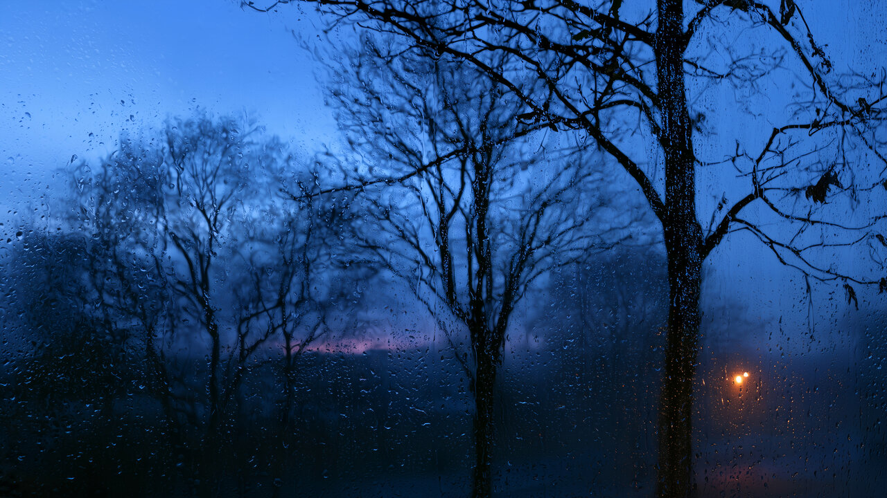
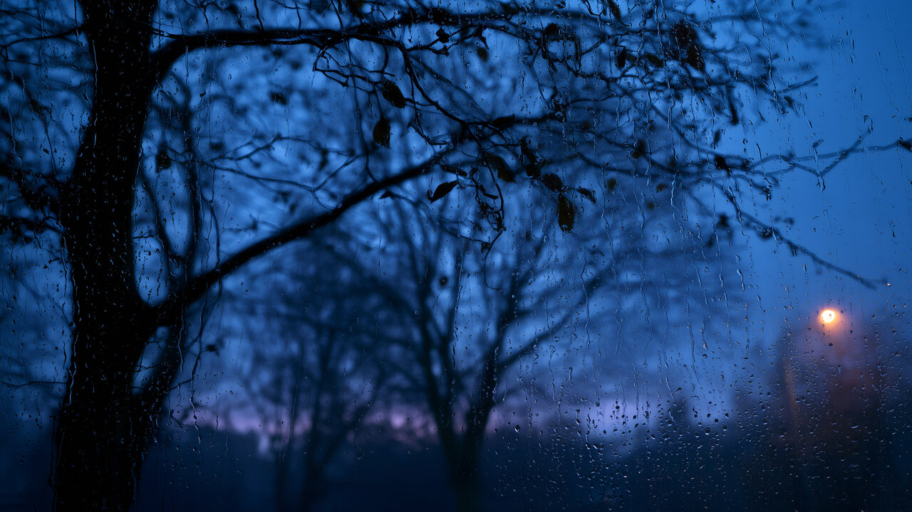
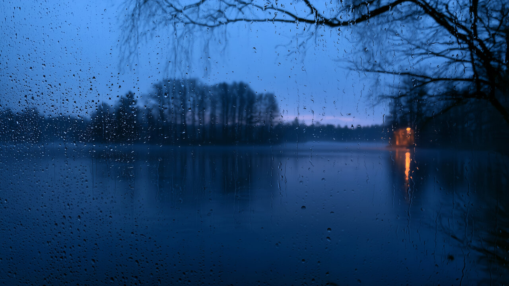

# Blue Hour

Blue twilight through a rain-misted window, with deep navy surfaces and a coordinated dark interface.


## Install

For **Omarchy 4 with Omarchy Shell**:

```sh
omarchy theme install https://github.com/erikrjohansson/omarchy-blue-hour-theme
```

## Update

To get new wallpapers and fixes, update your installed themes, then apply Blue Hour again so Omarchy picks up the new files:

```sh
omarchy theme update
omarchy theme set blue-hour
```

## Remove

Switch to another theme first (for example with `omarchy theme switcher`), then remove Blue Hour:

```sh
omarchy theme remove blue-hour
```

## The theme

- Bare trees at dusk seen through a wet window, with a last violet glow and one warm street lamp.
- A top bar in the same deep navy as the windows.
- Deep navy surfaces, soft cornflower accents, pale silver text, and lamp-gold for warnings.
- Translucent menus and shell panels, coordinated terminal and editor colors, GTK 3 / GTK 4 styling, and Adwaita icons.

## Wallpapers

Three 6K (6016 × 3384) wallpapers: dusk (default), branches and cabin. Switch between them with `omarchy theme bg next`, or from the Omarchy menu under Style → Background.

<table>
  <tr>
    <td width="33%"></td>
    <td width="33%"></td>
    <td width="33%"></td>
  </tr>
  <tr>
    <td align="center">Dusk</td>
    <td align="center">Branches</td>
    <td align="center">Cabin</td>
  </tr>
</table>

## Misted Glass collection

[Misty Sunset](https://github.com/erikrjohansson/omarchy-misty-sunset-theme) · [Blue Hour](https://github.com/erikrjohansson/omarchy-blue-hour-theme) · [Cool Dawn](https://github.com/erikrjohansson/omarchy-cool-dawn-theme)

## License

[MIT](LICENSE)
